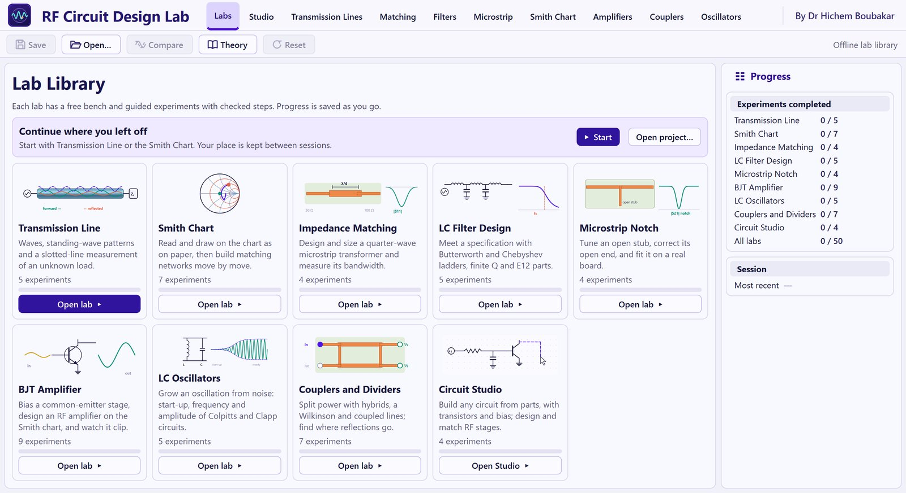
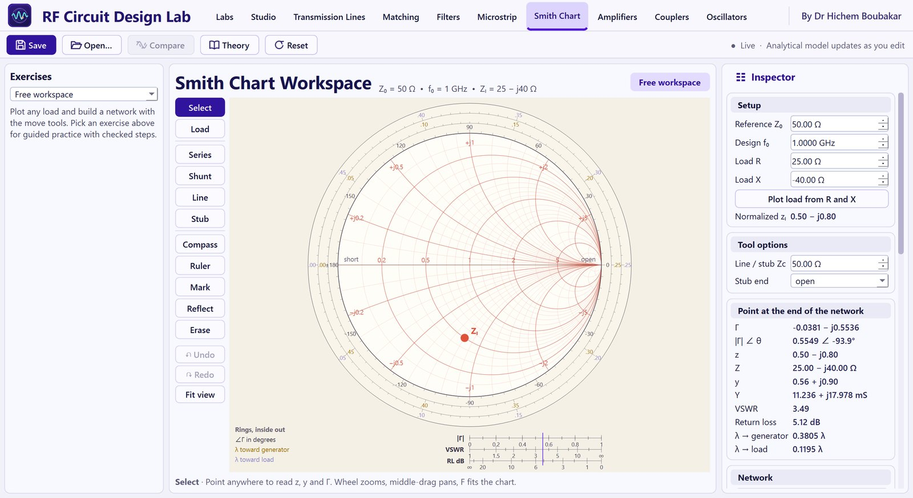
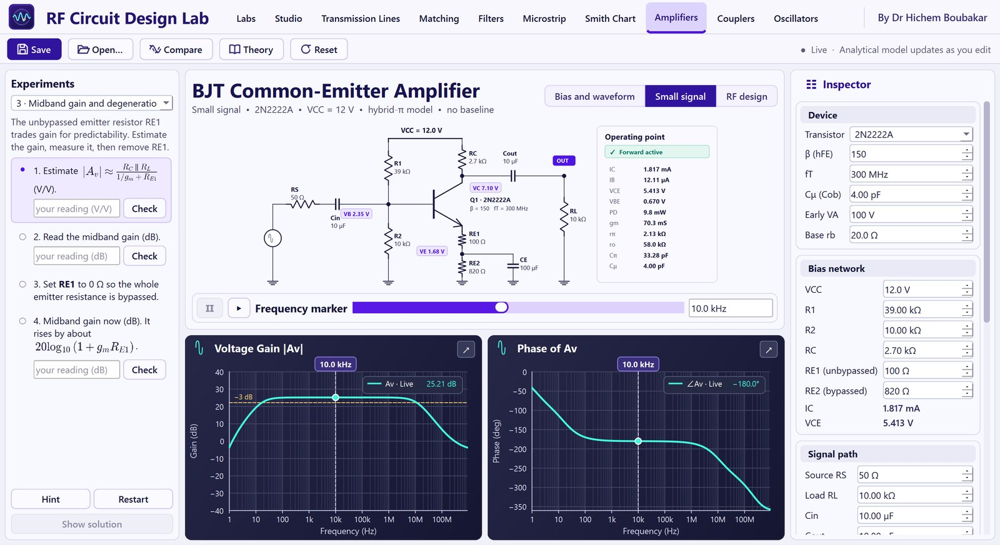
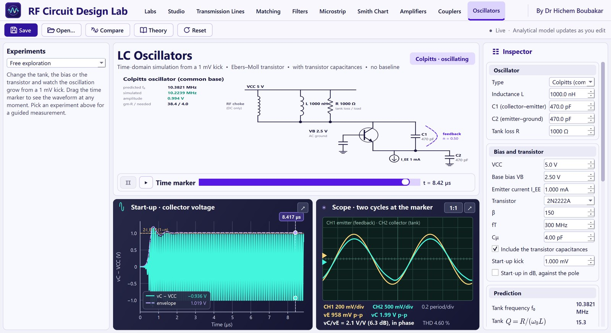
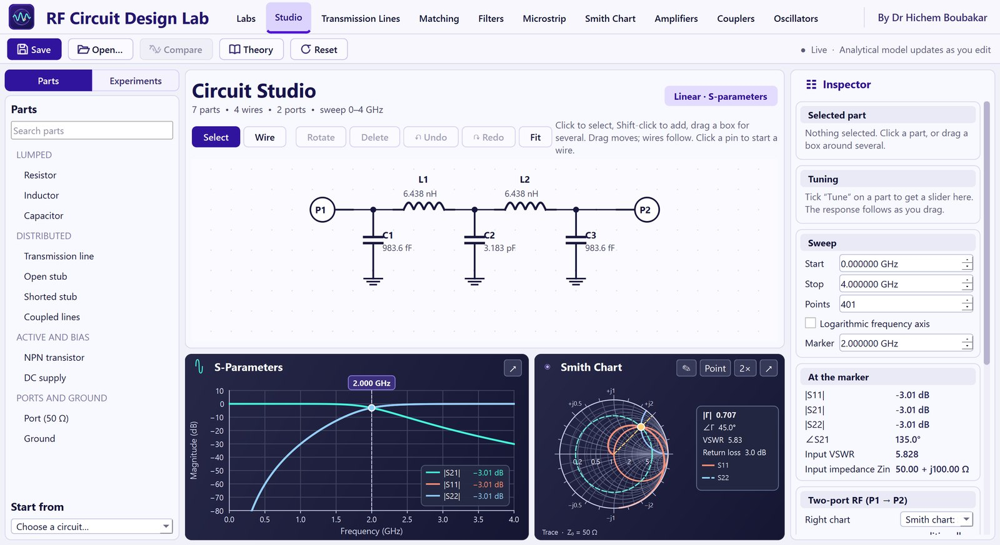

<h1 align="center">RF Circuit Design Lab</h1>

<b>Interactive RF and microwave circuit design labs for Windows, with textbook theory and guided experiments.</b> 
Free beta · v0.18 · Windows 10 and 11 (64-bit) · Works offline 
Created by <b>Dr Hichem Boubakar</b>

  <a href="https://github.com/hichemboubakar/rf-circuit-design-lab/releases/download/v0.18/RF-Circuit-Design-Lab-Setup-v0.18.exe"><b>⬇ Download the installer (76 MB)</b></a> ·
  <a href="https://hichemboubakar.github.io/rf-circuit-design-lab/">Website</a> ·
  <a href="https://github.com/hichemboubakar/rf-circuit-design-lab/releases">All versions</a> ·
  <a href="https://github.com/hichemboubakar/rf-circuit-design-lab/issues">Report a problem</a>

## What it is

RF Circuit Design Lab is a lab bench on your laptop. Every lab pairs a live circuit with its theory: change a value and every plot, readout and drawing updates at once.

- **Nine labs and a Circuit Studio:** Transmission Lines, Impedance Matching, LC Filters, Microstrip, the Smith Chart, BJT Amplifiers, Couplers and Dividers, LC Oscillators, and a Studio where you build any circuit from parts.
- **50 guided experiments** that check your readings, give hints, and show the worked solution after a first attempt.
- **A theory chapter for every lab**, with typeset equations, figures, worked examples and check-yourself questions.
- **A real Smith chart:** draw on classic paper with compass and ruler, and build matching networks move by move.
- **Real physics:** transmission-line and S-parameter models, a hybrid-π transistor, and a time-domain oscillator that grows from noise.
- **Save, compare and resume:** pin a baseline, save projects as `.rflab` files, and continue where you left off.

| | |
|---|---|
|  |  |
|  |  |

## Install

1. Download [`RF-Circuit-Design-Lab-Setup-v0.18.exe`](https://github.com/hichemboubakar/rf-circuit-design-lab/releases/download/v0.18/RF-Circuit-Design-Lab-Setup-v0.18.exe).
2. Open it. If Windows shows **“Windows protected your PC”**, click **More info**, then **Run anyway**. The installer is not yet signed with a paid certificate, so Windows does not recognise the publisher.
3. Accept the licence and click **Install**. No administrator rights are needed.
4. Start **RF Circuit Design Lab** from the Start menu.

To check the file is genuine, compare its SHA-256 checksum with the one in the [release notes](https://github.com/hichemboubakar/rf-circuit-design-lab/releases/tag/v0.18): in PowerShell, run `Get-FileHash .\RF-Circuit-Design-Lab-Setup-v0.18.exe`.

**Requirements:** Windows 10 or 11, 64-bit; about 280 MB of disk space; a 1280 × 720 or larger screen.

## Beta

All labs work and the physics is tested against closed-form results, but the app is still growing. Please [report problems and ideas](https://github.com/hichemboubakar/rf-circuit-design-lab/issues) with what you did, what you expected and what happened.

## Privacy

The app works offline and collects no data. Your session and projects stay on your own computer.

## Licence

Copyright © 2026 Dr Hichem Boubakar. All rights reserved. Free for learning and teaching; redistribution, modification and sale need the author's written permission. See [LICENSE.txt](LICENSE.txt). Please share a link to this page rather than the installer file.

The app includes open-source components, such as Qt for Python under the LGPL-3.0, NumPy, SciPy and scikit-rf. Their licences and notices are installed with the app. The source code of RF Circuit Design Lab itself is not published.
